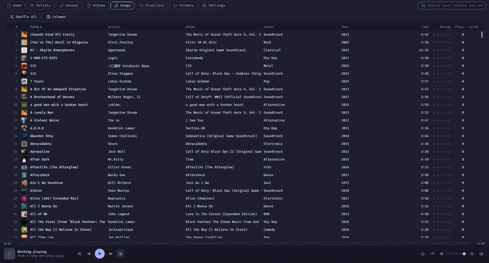

<div align="center">



# Seamless Music Player

**A light, good-looking music player for Windows, with Soulseek and YouTube search built in.**

Your local library, synced lyrics and a visualiser, in a dark frosted-glass look, using a fraction of the memory of the app it replaces.

<a href="https://github.com/DavidHiFi/seamless-music-player/releases/latest">

</a>

<br><br>


</div>

---

## Installation

1. Install it from [Seamless Workshop](https://github.com/DavidHiFi/seamless-workshop) (Settings, Extras), which also keeps it up to date.
2. Or download `SeamlessMusicPlayer-<version>-win64.zip` from the [latest release](https://github.com/DavidHiFi/seamless-music-player/releases/latest), unzip it anywhere and run `Seamless Music Player.exe`.
3. Add your music folders in Settings. Songs show up as soon as they land in a watched folder.

If you used Dopamine before, the first start brings over your library, plays, ratings, loved songs, playlists, queue and settings. Dopamine's own files are only read, never changed.

## Features

### Library

- **Browse:** home, artists, genres, albums, songs, playlists and folders, with artist and album pages.
- **Songs table:** pick your columns, sort, select with Shift and Ctrl, right-click for play next, queue, playlists, love and more.
- **Live pickup:** new files in your watched folders appear on their own.

### Playing

- **Playback bar:** wave or flat progress, shuffle, loop, sleep timer, speed, rating and love.
- **Now playing:** big artwork, synced lyrics and a blue to mauve visualiser.
- **Sound:** gapless playback, crossfade and a ten-band equaliser.
- **Mini player**, a tray icon, media keys and the Windows media overlay.

### Online

- **Search while you type:** Soulseek (through slskd) and YouTube results next to your library.
- **Stream or download:** downloads land in your Downloads folder and join the library.

### Extras

- **Scrobbling** to Last.fm and ListenBrainz, and an optional Discord status.
- **Motion you control:** every window, menu and toast fades in and out, with an on/off switch and a speed for each.

## Notes

> [!NOTE]
> **Soulseek search needs slskd.** Run [slskd](https://github.com/slskd/slskd) on the same PC. Video search uses [yt-dlp](https://github.com/yt-dlp/yt-dlp).

> [!IMPORTANT]
> **This is the first release.** It is a full rewrite, so tell me about anything that behaves differently from what you expect.

<details>
<summary><b>Building from source</b></summary>

<br>

Needs Rust (stable, MSVC) and the WebView2 runtime.

```powershell
cargo build --release
cargo test --release
target\release\smp.exe --selftest
powershell -File scripts\package.ps1   # makes dist\SeamlessMusicPlayer-<version>-win64.zip
```

</details>

## Contributing

Bug reports with steps to repeat them, screenshots and pull requests all help.

<a href="CONTRIBUTING.md">

</a>

## Star history

Thanks to everyone who starred it.

<a href="https://www.star-history.com/?repos=DavidHiFi%2Fseamless-music-player&amp;type=date">
  <picture>
    <source media="(prefers-color-scheme: dark)" srcset="https://api.star-history.com/chart?repos=DavidHiFi/seamless-music-player&amp;type=date&amp;theme=dark&amp;legend=top-left" />
    <source media="(prefers-color-scheme: light)" srcset="https://api.star-history.com/chart?repos=DavidHiFi/seamless-music-player&amp;type=date" />
    
  </picture>
</a>

## Credits

- **Author:** Myself, [DavidHiFi](https://github.com/DavidHiFi)

<!-- contributors:start -->
- **AI coding agents:** [Claude Code](https://github.com/anthropics/claude-code) and Halo Sparks

<p>
  <a href="https://github.com/DavidHiFi"></a>
  <a href="https://github.com/anthropics/claude-code"></a>
</p>
<!-- contributors:end -->

| Who | What |
|---|---|
| **Digimezzo** ([Dopamine](https://github.com/digimezzo/dopamine)) | The player this one is modelled on: its features, layout and library import. |
| **Catppuccin** ([palette](https://github.com/catppuccin/catppuccin)) | The Mocha colours. |
| **Tonsky** ([Fira Code](https://github.com/tonsky/FiraCode)) and [Nerd Fonts](https://github.com/ryanoasis/nerd-fonts) | The font the look is built around. Install it for the full look; without it the app uses a plain monospace font. |

Built on [Rust](https://www.rust-lang.org/), with [tao](https://github.com/tauri-apps/tao), [wry](https://github.com/tauri-apps/wry), [Symphonia](https://github.com/pdeljanov/Symphonia), [cpal](https://github.com/RustAudio/cpal), [lofty](https://github.com/Serial-ATA/lofty-rs) and [SQLite](https://www.sqlite.org/) through [rusqlite](https://github.com/rusqlite/rusqlite).

> Missing or wrong credit? [Open an issue](https://github.com/DavidHiFi/seamless-music-player/issues/new) and I'll fix it.

## Disclaimers

Most of this project's code was developed with AI coding agents, including Claude Code and Halo Sparks. No single AI agent made the project.

The app talks to the internet only for what you turn on: Soulseek and YouTube search, scrobbling and Discord status.

<div align="center">
<br>
<sub>Not affiliated with Last.fm, ListenBrainz, Soulseek or YouTube.</sub>
</div>
